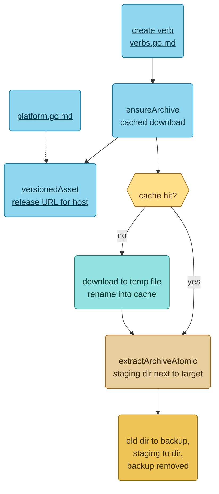

# Archive download and atomic extraction (`archive.go`)

`archive.go` fetches the pinned `actions/runner` release and unpacks it safely. It covers the whole path from URL to atomically-swapped install directory.

## Download

- `versionedAsset(cfg, p)` builds the asset name/URL (`actions-runner-<os>-<arch>-<version><ext>`) and the GitHub release URL from `cfg.RunnerVersion` (a leading `v` is tolerated).
- `ensureArchive` returns the cached archive path, downloading to a temporary file in the cache dir and atomically renaming it into place — interrupted downloads never poison the cache. A non-empty cached file is reused; non-200 status is an error. Callers pass `defaultHTTPClient()` (a 10-minute timeout) so a hung mirror cannot wedge `create`.
- Cache location: `cfg.ArchiveCache()` — `<runnersDir>/cache` by default (see [config.go.md](config.go.md)).

## Extraction

- `extractArchiveAtomic` unpacks into a staging dir **next to** the target, carries over `preserve` files from any previous install (`.runner`, `.credentials`, `.credentials_rsaparams` are the caller's list), stamps the `.runner-spawner.version` marker (`versionMarkerFile`, see `installedRunnerVersion`), then swaps: old dir → `<name>.old-<timestamp>`, staging → dir, backup removed. Any failure before the swap deletes the staging dir and leaves the previous install untouched; the swap itself rolls back on failure.
- `extractArchive` dispatches on extension (`.zip` → `extractZip`, otherwise `extractTarGz`) — pure Go, no external `tar`/`unzip`/7za. Archive paths are validated in `safeJoin` (absolute paths and `..` escapes are rejected); symlink entries are recreated; file modes are preserved.

## Where it is used

`create` (see [verbs.go.md](verbs.go.md)) downloads, then either skips extraction (marker version matches) or re-extracts atomically when the install is missing/partial. Crash-resume tests exercise this path with fake executors; actual runner archives are never downloaded by the test suite.

## Related pages

- [config.go.md](config.go.md) — archive cache resolution
- [platform.go.md](platform.go.md) — asset names per OS/arch
- [verbs.go.md](verbs.go.md) — the `create` flow that orchestrates this
