# Configuration (`config.go`)

```mermaid
flowchart LR
    Defaults("<img src='barnacle:file-code.svg' width='20' alt=''/><br/>Built-in defaults<br/>DefaultConfig") --> Git("<img src='barnacle:file-code.svg' width='20' alt=''/><br/><u>git remote detection<br/>owner/repo only</u>")
    Git --> File("<img src='barnacle:braces.svg' width='20' alt=''/><br/>.runner-spawner.json<br/>DisallowUnknownFields")
    File --> Env("<img src='barnacle:file-code.svg' width='20' alt=''/><br/>RUNNER_SPAWNER_* env vars<br/>ApplyEnv")
    Env --> Flags("<img src='barnacle:file-code.svg' width='20' alt=''/><br/><u>CLI flags<br/>applied in main.go</u>")
    Flags --> Config("<img src='barnacle:file-code.svg' width='20' alt=''/><br/>Config")
    Config --> Consumers("<img src='barnacle:file-code.svg' width='20' alt=''/><br/><u>verbs · archive · lifecycle<br/>consume the frozen Config</u>")
    click Git href "git.go.md"
    click Flags href "main.go.md"
    click Consumers href "verbs.go.md"
    class Defaults,Git,Env,Flags,Config,Consumers goFile
    class File jsonFile
    classDef goFile fill:#8fd8ef,stroke:#0277a8,color:#08303d
    classDef jsonFile fill:#cdb9f7,stroke:#6d28d9,color:#2e1065
```

`config.go` defines `Config` — every tunable of the CLI — and the layering that fills it. Precedence, lowest to highest: built-in defaults → git remote detection (owner/repo only) → `.runner-spawner.json` → `RUNNER_SPAWNER_*` env vars → CLI flags (applied in [main.go.md](main.go.md)).

## Defaults

`DefaultConfig()`: `RepoDir: .`, `RunnersDir: .runners`, `RunnerGroup: Default`, `RunnerVersion: 2.338.2`, `Format: text`. The config file is `.runner-spawner.json` (`DefaultConfigFile`).

## Loading

- `FindConfigFile(repoDir)` checks `<repoDir>/.runner-spawner.json`, then `./.runner-spawner.json`; `""` when neither exists.
- `LoadFile` parses with `DisallowUnknownFields` — unknown keys fail fast, so typos in the committed file are caught on first run. `WindowsPassword` is `json:"-"` and never serialised.
- `ApplyEnv` overlays the `RUNNER_SPAWNER_*` variables (see the `Env*` constants): a table drives the plain string overlays and the boolean ones, with list-valued and format-special cases handled separately. `RUNNER_SPAWNER_CONFIG` (file selection) and `RUNNER_SPAWNER_TOKEN` (see [token.go.md](token.go.md)) are consumed elsewhere and are intentionally not applied here. `getenv` is injectable for tests.
- `ParseList` splits comma-separated values; `ParseBool` parses boolean env values.

## Validation and resolution

- `Validate(needRepo)` requires non-empty `RunnersDir`/`RunnerGroup`/`RunnerVersion`; owner/repo only when `needRepo` (create/remove).
- `ResolveNames(flagNames)` — explicit `--name` wins over config/env; empty means the caller errors if it needs names.
- `RunnersRoot()` — absolute `<RepoDir>/<RunnersDir>` (or `RunnersDir` if absolute); `ArchiveCache()` — `<RunnersRoot>/cache` unless overridden; `AbsRepoDir()` returns the absolute repo dir.

## Related pages

- [git.go.md](git.go.md) — owner/repo fallback from the origin remote
- [main.go.md](main.go.md) — flag layering on top of this file
- [README.md — Configuration](README.md) (repo root; table of JSON keys ↔ env vars ↔ flags)
