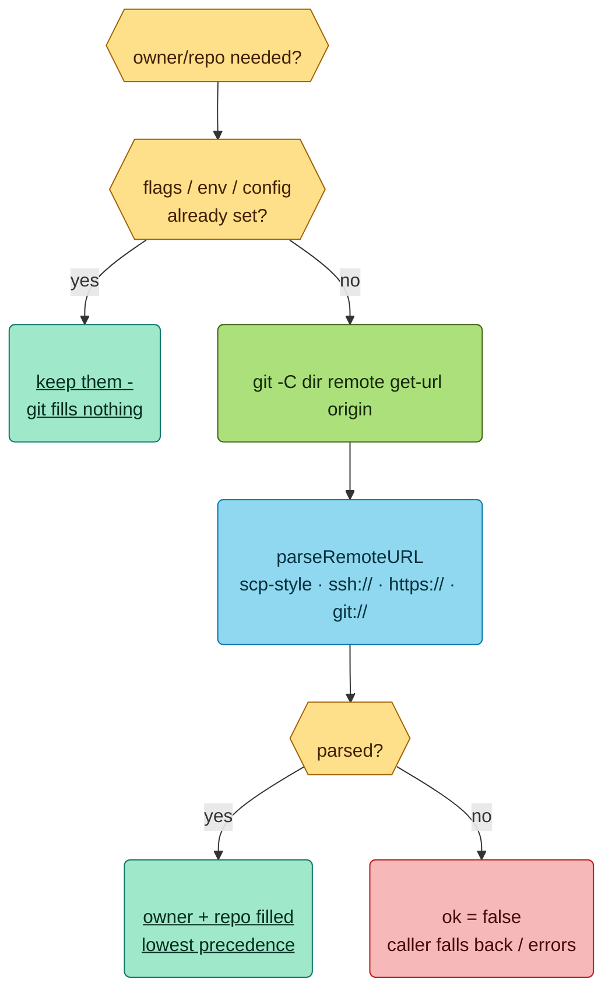

# Git remote detection (`git.go`)

`git.go` resolves the GitHub owner/repo from the target clone's `origin` remote — the lowest-precedence configuration source (see [config.go.md](config.go.md)).

## Functions

- `parseRemoteURL(raw)` extracts `(owner, repo)` from the forms git produces: scp-style (`git@github.com:owner/repo.git`), `ssh://`, `https://`, `git://` — with or without a trailing `.git` or trailing slash. It rejects empty input, whitespace, and anything that does not yield `<host>/owner/repo`.
- `detectGitRemoteOwnerRepo(dir)` runs `git -C <dir> remote get-url origin` and parses the result. It returns `ok=false` (and no error) when the directory is not a git clone or has no `origin`, so callers fall back to config/env/flags instead of failing.

## Where it is used

Called by the flag/config layer in [main.go.md](main.go.md) only while owner/repo are still unknown; fills just the missing half if one is set.

## Related pages

- [config.go.md](config.go.md) — the precedence this detection sits at the bottom of
- [main.go.md](main.go.md) — where the detection is invoked
