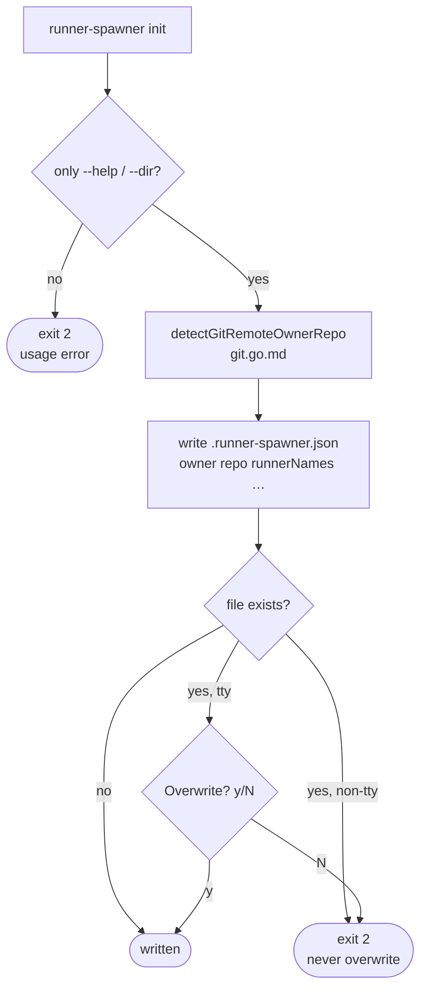

# `runner-spawner init` (`init.go`)

`init.go` implements `runner-spawner init [--dir DIR]`: write a `.runner-spawner.json` for a repository, detecting owner/repo from its git remote — the same bootstrap step the README walks through by hand.

## Behavior

- `runInit` parses only `--help`/`-h` and `--dir DIR` (default `.`); anything else is a usage error (exit `2`).
- It examines the target directory's `origin` remote via `detectGitRemoteOwnerRepo` (see [git.go.md](git.go.md)) and writes `<dir>/.runner-spawner.json` (`initFile`: owner, repo, `runnerNames: ["runner01"]`, `runnersDir: .runners`, `runnerGroup: Default`, `runnerVersion: 2.338.2`).
- **Never overwrites non-interactively**: if the file exists and stdin is not a terminal, it exits with code `2`; in a terminal it prompts `Overwrite? [y/N]` and proceeds only on an explicit yes.
- The file contains no secrets; the committed `.runner-spawner.json` at the repo root is this tool's own dogfooding.

`stdinIsTerminal` isolates the TTY check from `stdin`.

## Related pages

- [config.go.md](config.go.md) — the file it writes and how it is loaded
- [git.go.md](git.go.md) — owner/repo detection
- [main.go.md](main.go.md) — how `init` is wired into subcommand dispatch
