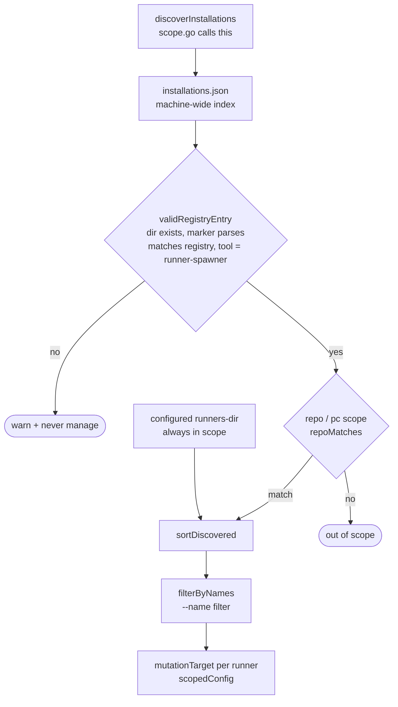

# Installation markers and the machine registry (`install.go`)

`install.go` implements scope-aware discovery of runner-spawner-managed installations on the local machine — the machinery behind `--scope repo` and `--scope pc`.

## Markers vs. registry

Every installation this tool creates carries `.runner-spawner-install.json` inside the runner dir. The marker is **authoritative**: it records the runner name, display name, owning repository (`owner`/`repo`/`owner/repo`), the clone's `repoDir`, install dir, platform/architecture, registration scope, service registration, and timestamps (`InstallationMeta`, `ServiceMeta` with `type` of `svc-sh`|`launchd`|`windows-service`|`unsupported`).

A machine-wide index, `<user-config-dir>/runner-spawner/installations.json` (e.g. `~/Library/Application Support/runner-spawner/installations.json` on macOS, `%AppData%\runner-spawner\installations.json` on Windows), lists installation dirs so `pc`-wide operations can find installations outside the current repo's `.runners/`. It is a convenience index, **not** a source of truth — losing it just limits discovery. A lock file (`installations.lock`) serializes registry writes (`withRegistryLock` → `atomicWriteFile`).

## Validation

`validRegistryEntry` keeps an entry only when the dir exists and its marker parses, matches the registry (name, installation dir, repo), and was written by runner-spawner (`Tool == "runner-spawner"`, `Version == 1`). Stale or unverifiable entries are reported as warnings and **never** managed. Installations under the configured root are always in scope and need no marker.

`discoverInstallations` selects registry matches for `repo` (repository or `repoDir` match — `repoMatches`/`repoFullNamesEqual`/`pathEqual`) or all valid entries for `pc`, unions them with the configured root, sorts deterministically (`sortDiscovered`), applies the `--name` filter (`filterByNames`), and builds per-target configs (`scopedConfig`). Pre-marker installations are adopted via `synthesizedMeta` when found through the configured root.

`create` writes the marker and registry entry (failure warns, does not fail — see [verbs.go.md](verbs.go.md)); `remove` unregisters the installation.

## Related pages

- [scope.go.md](scope.go.md) — the scopes that consume this discovery
- [verbs.go.md](verbs.go.md) — `recordInstallation` call site
