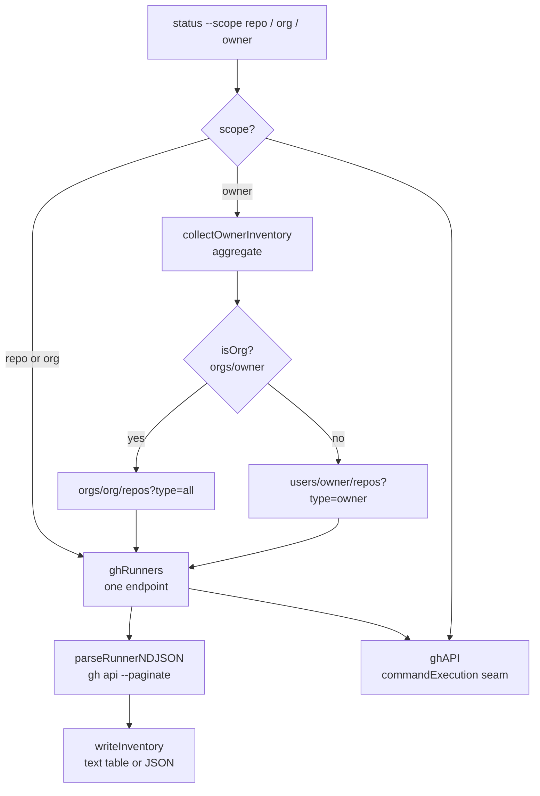

# GitHub runner inventory (`inventory.go`)

`inventory.go` implements read-only GitHub runner inventory for `runner-spawner status --scope repo|org|owner`. It talks to GitHub exclusively through the `gh` CLI, honoring `gh`'s existing authentication (`gh auth login`, `GH_TOKEN`, `GITHUB_TOKEN`). **Nothing in this file can start, stop, create or remove a runner — every call is a GET.**

## How it works

- `ghAPI` runs `gh api` (through the same `commandExecution` seam tests use, so no network in tests); `ghError` classifies failures (rate limit / 401 / 403 / 404) with actionable hints.
- `ghRunners` queries `repos/{owner}/{repo}/actions/runners` or `orgs/{org}/actions/runners` with `--paginate --jq '.runners[]'`; `parseRunnerNDJSON` decodes one JSON object per line, de-duplicating runners reached via multiple paths. `repoInventory`/`orgInventory` are the per-scope entry points, both backed by `runnersInventory`.
- `owner` aggregate scope has no universal endpoint, so `collectOwnerInventory` probes `isOrg` (`orgs/{owner}`) and delegates to `collectOrgInventory` (org-level runners, then `orgs/{org}/repos?type=all`) or `collectUserInventory` (`users/{owner}/repos?type=owner`) and queries each repository.
- Inaccessible targets are **partial failures** (`InventoryFailure`), never aborts: what was gathered is still printed, the command exits `1` with `failures[]` populated. Empty inventory with no failures is a success.

## Output

`writeInventory` emits the text table (ID, name, scope, repository/org, online/offline, busy/idle, labels, version) or `{scope, target, ok, runners[], failures[]}` JSON (via `writeJSONIndent`).

Key types: `InventoryRunner` (ID, Name, Scope, Repository/Organization, Status, Busy, Labels, Version, OS, Ephemeral), `InventoryFailure` (Scope, Target, Error), `inventoryResult`.

## Related pages

- [scope.go.md](scope.go.md) — how inventory mode is selected
- [main.go.md](main.go.md) — `runInventory` dispatch and the `--repo owner/repo` shorthand
