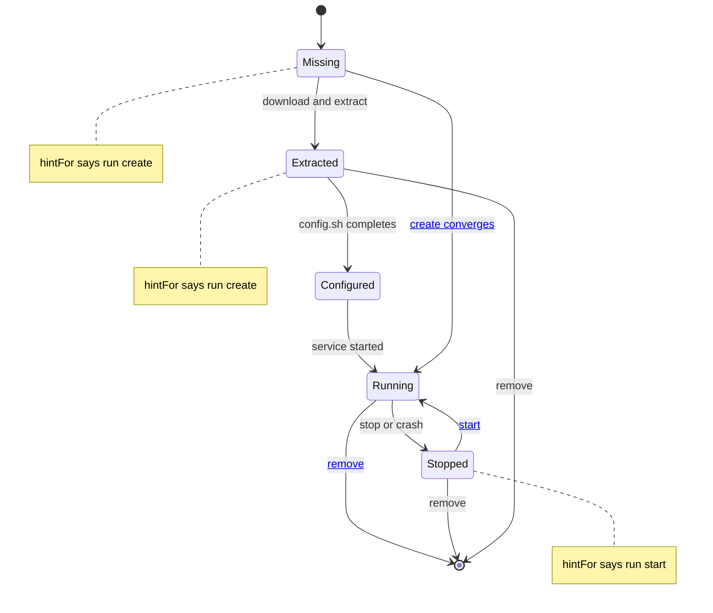

# Lifecycle state (`lifecycle.go`)

`lifecycle.go` defines the single source of truth for "where does this runner stand right now" and turns it into remediation hints. State is derived from disk (dir, `.runner`, version marker) plus a service probe — never from a journal file — so any interrupted operation can be resumed by re-running the same command.

## Key pieces

- `lifecycleState` — `Name`, `Dir`, `DirGone`, `Extracted`, `Configured`, `MarkerVersion`, `ServiceState` (`running|stopped|pending|not-installed|unknown|unsupported`).
- `DetectLifecycle(cfg, p, name)` — inspects one runner without mutating anything; probes the service via `queryServiceState` ([verbs.go.md](verbs.go.md)) unless the platform is unsupported (`ServiceState = "unsupported"`, e.g. Linux).
- `hintFor(p, st)` — maps the state to a remediation hint for `status` output (missing dir + live service → run `remove`; incomplete extraction / not configured / not installed → run `create`; stopped → `start`; pending → wait).
- `waitFor` — bounded poll loop used by service stop/start waits (`serviceTimeout = 60s`, `servicePollInterval = 500ms`, both overridable in tests).
- `windowsServiceStateFromOutput` — parses `sc.exe query` output using the **locale-independent numeric STATE code** (1 = stopped, 2/3/5/6 = pending, 4 = running; default 7 = unknown) because sc.exe's textual labels are localized. The English-substring match is a documented fallback only.

## Where it is used

`status`/`list` render `hintFor` output directly; `create`/`remove`/`start`/`stop` read `DetectLifecycle` to decide what to skip, repair, or redo (see [verbs.go.md](verbs.go.md)).

## Related pages

- [verbs.go.md](verbs.go.md) — the probes and the verbs that consume this state
- [runner.go.md](runner.go.md) — the low-level existence/config checks
- [platform.go.md](platform.go.md) — platform support gate
