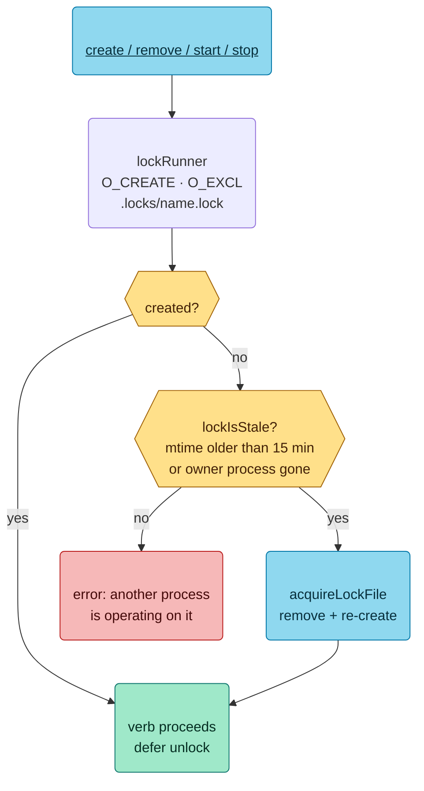

# Mutation lock files (`lock.go` + `lock_unix.go` + `lock_windows.go`)

Mutating verbs on the same runner are serialized through a lock file so concurrent or interrupted runs cannot interleave. This page covers `lock.go` (the shared logic) and the two `processAlive` probes selected by build tags — they are one mechanism, split by platform.

## `lock.go` — the mechanism

- `lockRunner(runnersRoot, name)` creates `<runnersRoot>/.locks/<name>.lock` with `O_CREATE|O_EXCL` and writes `pid=`/`created=` lines. The returned function releases it (deletes the file) — callers `defer` it immediately after acquiring.
- `lockStaleAge` (15 minutes) caps how long a lock may be held. `lockIsStale` takes a lock over when: the file's mtime is older than the cap, `processAlive(pid)` says the owner is gone, or the lock is unparseable/empty. Otherwise the caller gets an explicit "another runner-spawner process (pid N) is operating on runner X" error naming the runner and lock path.
- Stale takeover is two-phase by design (`acquireLockFile`, two attempts): remove the stale lock, re-create it exclusively.
- Age is judged by **file mtime**, not the `created=` timestamp, so clock skew does not matter.

## `lock_unix.go` / `lock_windows.go` — the probe

Both expose one function, `processAlive(pid int) bool`:

- Unix (`//go:build !windows`): `syscall.Kill(pid, 0)` — `nil`/`EPERM` mean alive, `ESRCH` means gone.
- Windows (`//go:build windows`): conservatively reports `true` (OpenProcess would need another dependency), so Windows stale-lock takeover relies solely on the 15-minute age cap. The header comment says exactly this.

## Where it is used

Every mutating verb (`createOne`/`removeOne`/`startOne`/`stopOne` call `lockRunner` first — see [verbs.go.md](verbs.go.md)). An interrupted run therefore cannot wedge a runner forever: re-running after 15 minutes (or after the owner process disappears on Unix) converges.

## Related pages

- [verbs.go.md](verbs.go.md) — the verbs that hold the lock
- [main.go.md](main.go.md) — `<runnersDir>/.locks/<name>.lock` is the documented user-facing contract
