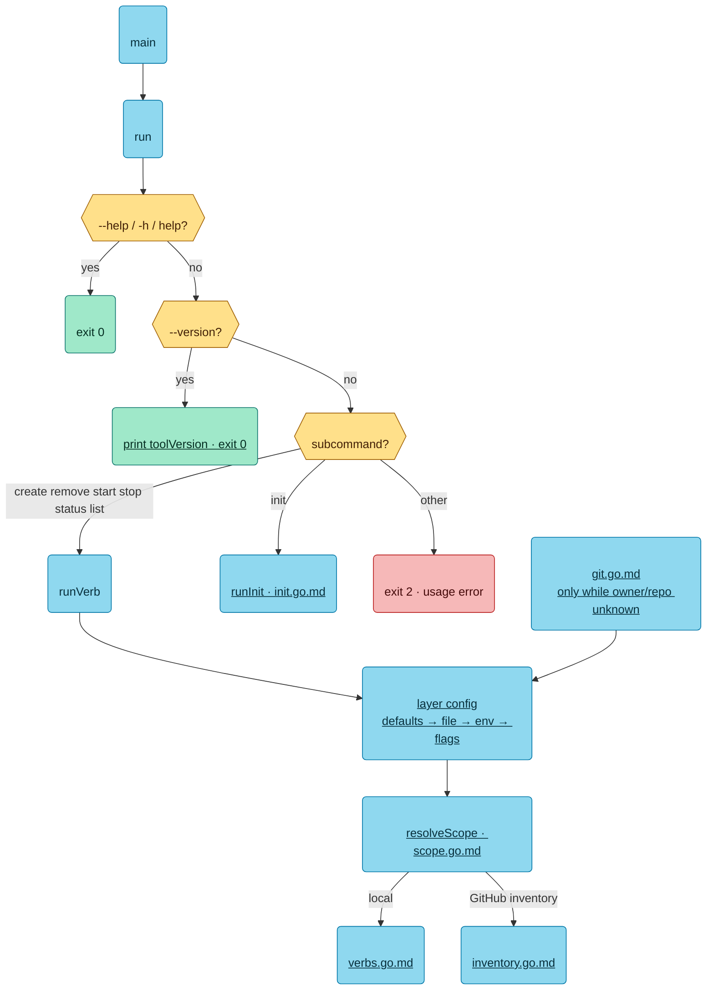

# Command entry point (`main.go`)

`main.go` is the CLI itself: subcommand dispatch, flag parsing, config layering, and output. The binary is `runner-spawner`; `toolVersion` (see [version.go.md](version.go.md)) is stamped at link time.

## Shape

- `main()` maps `run()`'s error to the exit code via `exitCode()`. `codedError` carries an explicit code; everything else is `1`. `reportedError` marks errors whose message was already printed (flag package output), so `run` does not print twice.
- `runInner` handles `--help`/`-h`/`help`, `--version`/`-version`/`version`, the verb subcommands (`create`, `remove`, `start`, `stop`, `status`, `list`), `init`, and usage errors for anything else. `printUsage` prints the `usageText` table line by line (help and subcommand-error paths share it).
- `runVerb` parses the shared flag set (`--config`, `--repo-dir`, `--owner`, `--repo`, `--name` [repeatable/comma-separated via `nameFlag`], `--scope`, `--org`, `--github`, plus runner-shaping knobs), then layers configuration: built-in defaults → git remote (owner/repo only, [git.go.md](git.go.md)) → `.runner-spawner.json` ([config.go.md](config.go.md)) → `RUNNER_SPAWNER_*` env vars → CLI flags. Format is validated (`text`|`json`) before dispatch.
- `resolveScope` (see [scope.go.md](scope.go.md)) decides local vs. GitHub-inventory mode; inventory mode is dispatched to `runInventory` (see [inventory.go.md](inventory.go.md)), otherwise list/status/mutation logic lives in [verbs.go.md](verbs.go.md).

## Exit codes

`0` success, `1` runtime error (including inventory/batches with reported failures), `2` bad flags/config (`usageErrf`; a `codedError{code: 2}`). Errors are printed to stderr as `runner-spawner: <err>`; `--quiet` suppresses status logs, never errors.

## Output

`writeStatus` emits the `list`/`status` table (or `{scope, runners[], repo?}` JSON); `writeMutationJSON` emits `{scope, results[], repo?}` for the mutating verbs. In `directory` scope the classic `repo` key is kept for compatibility. All JSON output goes through `writeJSONIndent`. The `list`/`status`/`create`/`remove`/`start`/`stop` paths share `simpleTargets` (directory-scope targets bound to one `Config`) and `statusForTargets` (the per-target `statusOne` loop); scoped "no managed installations found" results go through `writeEmptyScopeStatus`.

## Related pages

- [config.go.md](config.go.md) — configuration layering and `DefaultConfig`
- [verbs.go.md](verbs.go.md) — the mutating verbs and status assembly
- [scope.go.md](scope.go.md) — `--scope` resolution and batch dispatch
- [inventory.go.md](inventory.go.md) — `status --scope repo|org|owner` (GitHub, read-only)
