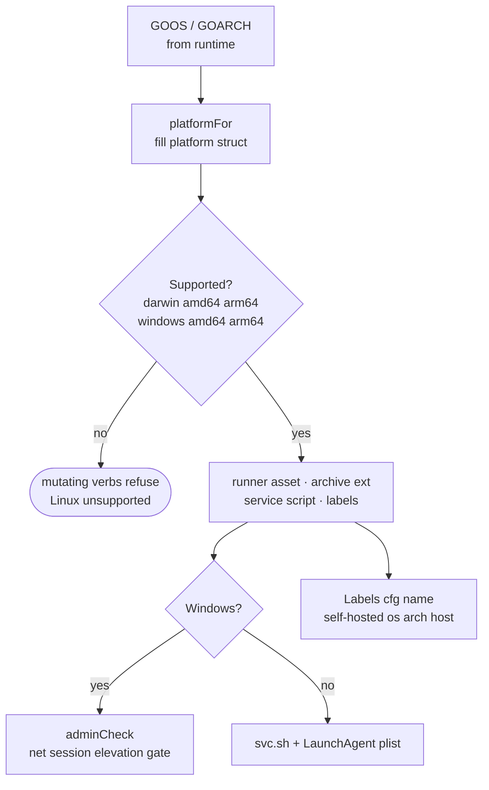

# Platform detection (`platform.go`)

`platform.go` describes what the host machine can run and how its runner is supervised. **Supported at runtime: macOS (`darwin/amd64`, `darwin/arm64`) and Windows (`windows/amd64`, `windows/arm64`) only. Linux reports an explicit unsupported error for the mutating verbs; the Linux asset names are still filled in so `status`/`list` diagnostics can describe the host, and Linux binaries are cross-compiled so the release/bundle layout stays uniform.**

## The `platform` struct

`platform{GOOS, GOARCH, RunnerAsset, ArchiveExt, ConfigBin, ServiceBin, IsWindows, Supported, OSLabel, ArchLabel, hostname}` — the Actions release asset stem (e.g. `actions-runner-osx-x64`), archive extension (`.tar.gz` Unix / `.zip` Windows), service script name per OS, and the label components reported to Actions.

`platformFor(goos, goarch, hostname)` fills it; `currentPlatform` (a var) captures the real host for tests to stub. macOS: `config.sh` + `svc.sh`; Windows: `config.cmd` + `sc.exe` (`ServiceBin` empty). Unknown GOOS/GOARCH leaves `Supported` false.

## Labels

`Labels(cfg, name)` returns `self-hosted,<os>,<arch>,<host>,<host>-<name>` by default (e.g. `self-hosted,macos,x64,maestro,maestro-runner01`); any explicit `cfg.Labels` (from `--labels` / `RUNNER_SPAWNER_LABELS` / config) replaces the auto-detection wholesale.

## Enforcement and helpers

- `requireSupported(verb)` — refuses the mutating verbs on unsupported platforms with a message naming the platform (Linux gets its own, clearer error).
- `adminCheck(p)` — Windows-only elevation gate via `net session` (the old `_admin_check.sh` equivalent); localized Windows builds are fine because the check is exit-code based. No-op elsewhere.
- `runnerURL()` — `https://github.com/<owner>/<repo>`; `hostname()` — the host's name with a `"host"` fallback.

## Related pages

- [runner.go.md](runner.go.md) — consumes `platform` for paths and script names
- [archive.go.md](archive.go.md) — uses `RunnerAsset`/`ArchiveExt` for downloads
- [verbs.go.md](verbs.go.md) — enforces `requireSupported`/`adminCheck` in create/remove/start/stop
