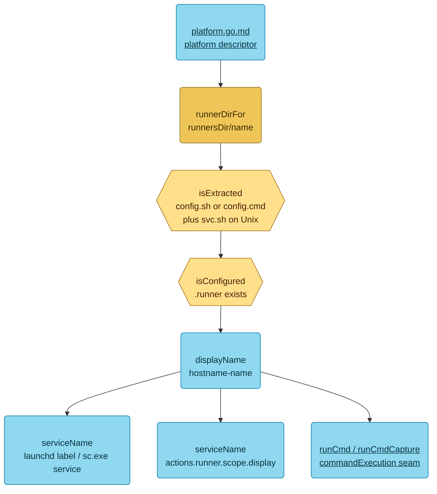

# Runner paths and identity (`runner.go`)

`runner.go` collects the small helpers that name and probe a runner installation on disk. They contain no lifecycle logic (that is [verbs.go.md](verbs.go.md) and [lifecycle.go.md](lifecycle.go.md)) — just path math and existence checks, built on the `platform` descriptor from [platform.go.md](platform.go.md).

## Key functions

- `runnerDirFor(cfg, name)` — `<runnersDir>/<name>` (the on-disk dir is just the name; the Actions display name is not).
- `displayName(name)` — `hostname-name` (e.g. `maestro-runner01`), the Actions runner display name.
- `runnerExists(dir)` / `isConfigured(dir)` — directory exists; `.runner` file exists (config.sh done).
- `isExtracted(dir, p)` — `config.sh` (or `config.cmd`) is a regular file, plus `svc.sh` on non-Windows. Anything less means an interrupted extraction to repair.
- `configScript(dir, p)` / `serviceScript(dir, p)` — absolute paths of the runner's scripts.
- `serviceName` — `actions.runner.<owner>-<repo>.<display>`, used as both the sc.exe service name (Windows) and the launchd label / plist basename (macOS), matching how the Actions runner registers itself; `macosServicePlist(homeDir, cfg, name)` — the user-level LaunchAgent plist path, using the `userHomeDir` seam so tests can redirect it.
- `runCmd` / `runCmdCapture` — thin wrappers over the `commandExecution` seam (see [script.go.md](script.go.md)) for `sc.exe`/`net`-style invocations.

## Where it is used

Every lifecycle verb: `create` consults `isExtracted`/`isConfigured` to decide what to redo; `status`/`list` report `isConfigured` via [verbs.go.md](verbs.go.md); `remove` cleans up using the same paths.

## Related pages

- [platform.go.md](platform.go.md) — the `platform` struct these helpers consume
- [lifecycle.go.md](lifecycle.go.md) — disk state turned into a resume decision
- [script.go.md](script.go.md) — the subprocess seam under `runCmd`
