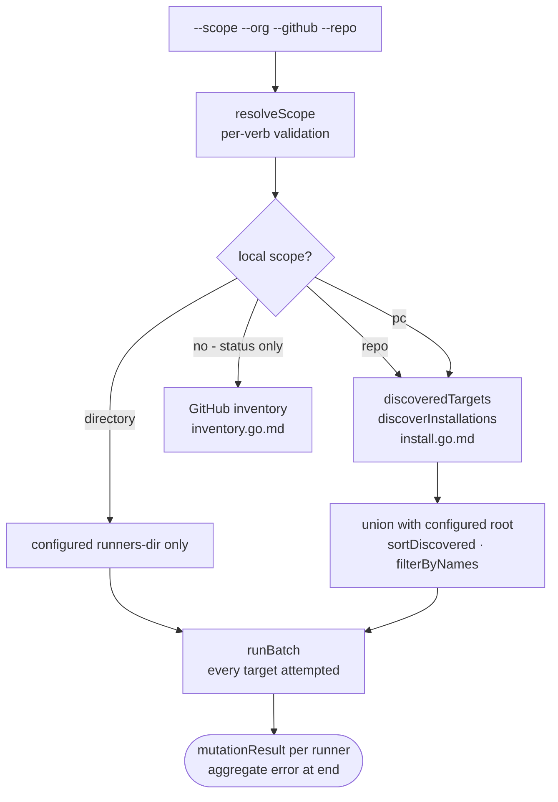

# Scope resolution and batch execution (`scope.go`)

`scope.go` turns the `--scope`/`--org`/`--github` flags into either a **local** scope (`directory`|`repo`|`pc`) or a **GitHub inventory** scope (`repo`|`org`|`owner`, read-only, `status` only), and implements the shared batch runner for the mutating verbs.

## Scope semantics

- `directory` (default) — only the configured `--runners-dir`; the classic pre-scope behavior.
- `repo` — every installation of the current repository, including other clones/working directories (matched via the machine registry; see [install.go.md](install.go.md)).
- `pc` — every runner-spawner-managed installation on this machine.
- `repo`/`org`/`owner` for `status` — read-only GitHub inventory (see [inventory.go.md](inventory.go.md)); `org`/`owner` are rejected for other verbs, as are `--org`/`--github`. `create`/`remove` accept only `directory`.
- `--repo owner/repo` (contains a slash) implies GitHub inventory mode for `status`; `--github` forces it.

`resolveScope` validates per verb and returns `(localScope, githubScope, err)`; the `--repo owner/repo` shorthand is split by `splitOwnerRepo` (trimmed, both parts non-empty, no second slash); `discoveredTargets` maps a non-directory scope to per-runner `mutationTarget`s via `discoverInstallations`; `printWarnings` reports skipped/stale registry entries on stderr.

## Batch semantics

`runBatch` attempts **every** target, never aborts on first failure, accumulates per-runner `mutationResult`s (`name`, `repo`, `ok`, `error`), and returns an aggregate error naming the failures (exit `1`) when any target failed. With `--format json`, output is a `results` array; without, failures are printed as they happen.

## Related pages

- [install.go.md](install.go.md) — the marker/registry that makes `repo`/`pc` discovery possible
- [inventory.go.md](inventory.go.md) — the GitHub side of the scope split
- [verbs.go.md](verbs.go.md) — the per-installation verb implementations
- [main.go.md](main.go.md) — where scope resolution is invoked
