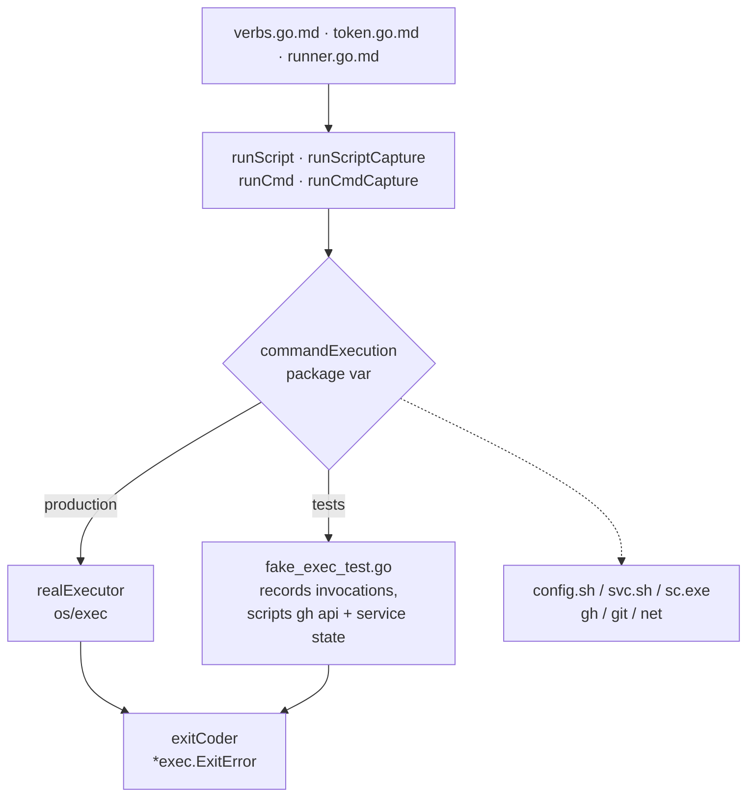

# Subprocess seam (`script.go`)

`script.go` is the only place the tool spawns external commands (`.runner` scripts, `sc.exe`, `net`, `gh`, `git`). All of it goes through one interface so tests can run hermetically — the whole create/remove/start/stop state matrix is covered by `fake_exec_test.go` without network, real services, or a Windows machine.

## The seam

- `commandExecutor` — `Run(name, args, dir)` (streams stdio, for scripts the user should see) and `Output(name, args, dir)` (combined output, for probing). `commandExecution` is a package var pointing at `realExecutor{}`; tests swap it for a fake.
- `realExecutor` — plain `os/exec`; `Run` inherits stdin/stdout/stderr, `Output` uses `CombinedOutput()`.
- `exitCoder` — implemented by `*exec.ExitError` and by test fakes, so callers can assert on specific exit codes (e.g. `sc.exe`'s 1060 "service does not exist") without spawning processes.

## Call-site helpers

- `runScript(script, args...)` / `runScriptInDir(script, args, dir)` — run `config.sh`/`config.cmd`, `svc.sh`. Runner scripts must be invoked with `dir` == the runner root.
- `runScriptCapture(script, args...)` / `runScriptCaptureInDir(...)` — same, with combined output (e.g. `svc.sh status`).

## Test posture

Because every subprocess funnels through `commandExecution`, `go test ./...` runs fully offline; the fake executor records invocations and simulates `.runner`/service state, including scripted `gh api` endpoints and per-runner-dir service failures. See [AGENTS.md — Build/Test](AGENTS.md).

## Related pages

- [runner.go.md](runner.go.md) — `runCmd`/`runCmdCapture` wrappers
- [verbs.go.md](verbs.go.md) — the lifecycle operations built on this seam
- [token.go.md](token.go.md) — `gh api` goes through the same seam
