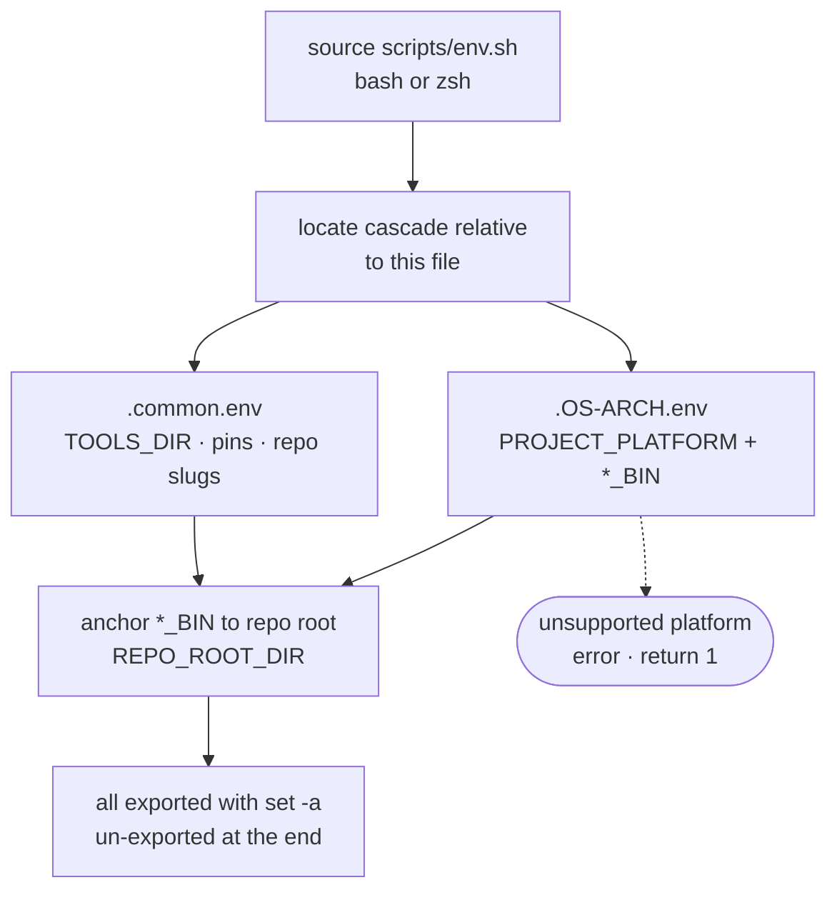

# The environment cascade (`scripts/env.sh` + the hidden `.*.env` files)

`scripts/env.sh` makes the pinned helper tools resolvable from any script, in any working directory, on every supported platform. It is sourced — never executed — and works from both bash and zsh.

## What it does

1. Locates the cascade relative to itself (bash via `$BASH_SOURCE`, zsh via `$ZSH_VERSION`), so sourcing works from any cwd.
2. Sources `.common.env`, then the platform file selected by `uname -s`/`uname -m` — for example `.macos-arm64.env` or `.windows-x86_64.env` (`Darwin`/`darwin` → `macos-*`, `Linux` → `linux-*`, `MINGW*`/`MSYS*`/`CYGWIN*` → `windows-*`). Unsupported platforms print an error and return `1`.
3. **Anchors** every repository-relative `*_BIN` to the repository root (`REPO_ROOT_DIR`), leaving absolute paths untouched. After sourcing, `$VERSIONER_BIN`, `$LOGAMUFFIN_BIN`, `$RUNNER_SPAWNER_BIN`, and `$BARNACLE_BIN` are absolute.
4. Sets `REPO_ROOT_DIR` for callers that need the repository root (for example [version.sh.md](version.sh.md)).

Everything is exported with `set -a` while sourcing and un-exported at the end.

## The hidden files

Hidden files are excluded from barnacle's default scan, so their contract is documented here:

- **`.common.env`** — `TOOLS_DIR=tools`; the upstream repository slugs (`VERSIONER_REPO=fordaj/Versioner`, `LOGAMUFFIN_REPO=fordaj/logamuffin`, `RUNNER_SPAWNER_TOOL_REPO=fordaj/runner-spawner`, `BARNACLE_REPO=fordaj/barnacle`); `VERSIONER_TAG_PATTERN=v[0-9]*` and `VERSIONER_CONFIG_FILE=.versioner.json`; and the pinned version directories: **versioner `v0.0.3.0.17`, logamuffin `v0.1.3.0.35`, runner-spawner `v0.0.1.2.15`, barnacle `v0.0.1.0.17`**. (The formattington-lite bundle, pinned at `v0.0.3.0.67`, is deliberately not in the cascade — see `tools/formattington-lite/update.sh.md`.) When bumping a pinned tool, this file names the version directory the platform files point into.
- **`.<platform>.env`** — one per supported platform (`linux-arm64`, `linux-x86_64`, `macos-arm64`, `macos-x86_64`, `windows-arm64`, `windows-x86_64`). Sets `PROJECT_PLATFORM` and the `*_BIN` paths (including `BARNACLE_BIN`), all relative to the repository root. Notable recorded caveats: the Linux platform files note that runner-spawner reports unsupported on Linux (macOS + Windows only) and that the Linux binaries ship only for a uniform bundle layout; `.windows-arm64.env` pins `VERSIONER_BIN` at the `windows-x86_64` binary and records that there is no windows-arm64 versioner bundle upstream.

## Related pages

- [entry.sh.md](entry.sh.md) — the entry point most scripts source (it loads this file and defines `log()`)
- [docs.sh.md](docs.sh.md) — the docs generator that resolves `BARNACLE_BIN` through this cascade
- `tools/README.md` — the bundles selected by the `*_BIN` variables (excluded from the generated site)
