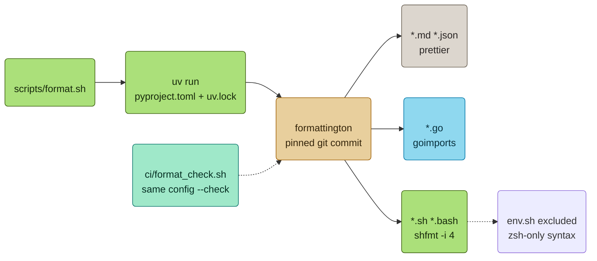

# Formatting the repository (`scripts/format.sh`)



`scripts/format.sh` formats the repository in place using [formattington](https://github.com/fordaj/formattington), pinned in `pyproject.toml` (git commit `dbed7479…`) and locked in `uv.lock`. No pip/venv setup is needed: `uv run` creates `.venv/` automatically (Python 3.14, see `.python-version`).

## Usage

```bash
./scripts/format.sh              # format all matching files in place
./scripts/format.sh --series     # format sequentially (ordered output)
./scripts/format.sh --verbose    # show which formatter executables were resolved
```

Extra flags are forwarded to `formattington` before `all`; `--config` is managed by the script — do not pass it.

## Scope (`.formattington.json`)

- Markdown (`*.md`) / JSON (`*.json`) → `prettier`
- Go (`*.go`) → `goimports` (gofmt + import fixing)
- Shell (`*.sh`, `*.bash`) → `shfmt -i 4` — run against the explicit file list (`scripts/format.sh`, `scripts/release.sh`, `ci/format_check.sh`, `scripts/entry.sh`, `scripts/version.sh`); `scripts/env.sh` is intentionally excluded because it contains zsh-only syntax no bash-compatible parser can read

## Prerequisites

`uv`, Go (with `goimports` on PATH — `scripts/format.sh` prepends `$(go env GOPATH)/bin`), `shfmt`, and `prettier`. Formattington exits `127` if a formatter executable is missing. Style is configured by `.prettierrc`; the bundled binaries under `tools/` and `dist/` are skipped.

To check formatting without modifying files (as CI does), `ci/format_check.sh` runs the same configuration with `--check`.

## Related pages

- [AGENTS.md — Build/Test](../AGENTS.md)
- [README.md — Development](../README.md)
