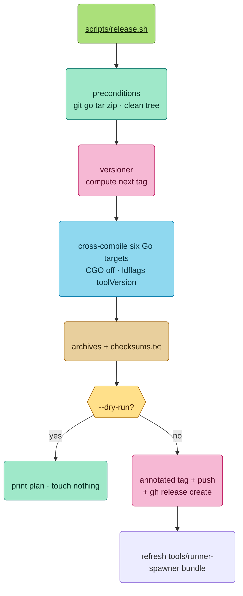

# The release pipeline (`scripts/release.sh`)

`scripts/release.sh` versions, builds, packages, tags and publishes a GitHub release for runner-spawner. Everything it does flows through the [scripts](README.md) tooling and the pinned tools (`tools/README.md`).

## What a release produces

For each of six Go targets (`darwin amd64`, `darwin arm64`, `linux amd64`, `linux arm64`, `windows amd64`, `windows arm64`): `dist/<goos>-<goarch>/runner-spawner[.exe]`, cross-compiled CGO-disabled with `-ldflags "-X main.toolVersion=<tag>"`. Linux binaries are built **for a uniform bundle layout only** — the mutating verbs refuse to run on Linux at runtime (see [../platform.go.md](../platform.go.md)).

Each architecture is packed into a flat `RunnerSpawner_<tag>_<arch>.tar.gz` (`.zip` on Windows) carrying the binary plus `README.md` and `LICENSE`, plus a `checksums.txt` (SHA-256) for all archives.

## The pipeline

1. Preconditions: `git`, `go`, `tar`, `zip`; clean working tree (warns but allows in `--dry-run`); `git fetch origin --tags` for the remote tag-existence check.
2. Resolves versioner: `VERSIONER_BIN` if set, else the newest bundled `tools/versioner/v*/<host-platform>/versioner[.exe]`, else `versioner` on PATH. Computes `VERSION=`/`TAG=` with `versioner --repo-dir <root>`; the tag must match `vX.Y.Z.W.V` and must not exist locally or on origin.
3. Cross-compiles the six binaries (the Makefile's `cross` target is the Unix convenience equivalent) and smoke-tests the native binary — its `--version` output must contain the tag.
4. Packs the archives, generates `checksums.txt`, then creates an annotated tag and pushes it, and `gh release create` with the archives and checksums (`--generate-notes`). `--dry-run` stops before tag/push/release, printing what it would do. Afterwards it reminds you to refresh the bundle with `tools/runner-spawner/update.sh`.

Prerequisites for a real release: `gh` authenticated (`gh auth login`). Unknown arguments exit `2`.

## Related pages

- [README.md](README.md) — the scripts hub
- [../version.go.md](../version.go.md) — where the stamped `toolVersion` is read
- `tools/versioner/update.sh.md` · `tools/runner-spawner/update.sh.md` (excluded from the generated site)
