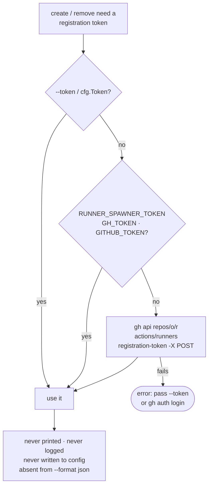

# Registration tokens (`token.go`)

`token.go` resolves the short-lived **registration token** the runner needs to register with GitHub. The token is never printed, never logged, never written to `.runner-spawner.json`, and is absent from `--format json` output. Callers in dry-run mode must not call this.

## Precedence

1. `--token` / `cfg.Token` (set by the flag layer)
2. `RUNNER_SPAWNER_TOKEN` (`EnvToken`), then `GH_TOKEN`, then `GITHUB_TOKEN` (environment)
3. `gh api repos/<owner>/<repo>/actions/runners/registration-token -X POST -q .token` — the same call as the old `_get_token.sh`; requires `gh` on PATH and a logged-in `gh` (or `GH_TOKEN`/`GITHUB_TOKEN`)

## Details

- The `gh` call goes through the `commandExecution` seam ([script.go.md](script.go.md)), so tests never hit the network.
- Output handling tolerates `gh` printing a bare token or a JSON string (unmarshals when it starts with `"`); empty output errors out, pointing at `gh auth status`.
- Failure messages classify the exit code: pass `--token` / run `gh auth login`.

## Where it is used

`create` and the GitHub-deregistration path of `remove` (see [verbs.go.md](verbs.go.md)). `status` inventory mode does **not** need a registration token — it reuses `gh`'s existing read-only credentials (see [inventory.go.md](inventory.go.md)).

## Related pages

- [main.go.md](main.go.md) — where `--token` and `RUNNER_SPAWNER_TOKEN` are wired in
- [verbs.go.md](verbs.go.md) — create/remove call sites
- [script.go.md](script.go.md) — the subprocess seam underneath
