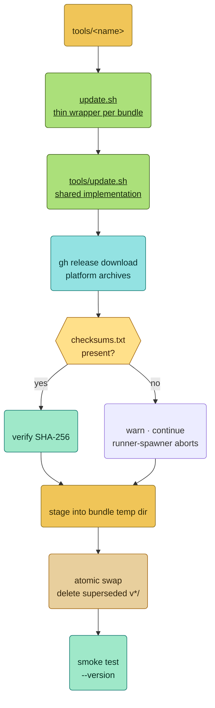

# Pinned helper tools (`tools/`)



`tools/` carries the repository's pinned helper binaries — release, logging, docs, and formatting tooling — plus one `update.sh` per tool that refreshes them. These are **not** the GitHub Actions runner the CLI installs (the runner archive is downloaded and cached per repository under `<runnersDir>/cache/`); they are the tools used to build, release, log, and document this repository itself.

## Bundling convention

Every bundle follows the same layout:

```text
tools/<name>/
  update.sh           # refresh from the upstream GitHub release
  v<version>/<platform>/<binary>[.exe]
```

- Binaries are pinned by version directory; the pinned version is named by `*_VERSION_DIR` in [`scripts/.common.env`](../scripts/env.sh.md) (except formattington-lite, which is standalone — see its page).
- `<platform>` is the hyphenated `<os>-<arch>` name (`linux-x86_64`, `macos-arm64`, `windows-x86_64`, …).
- `update.sh` downloads the latest (or `--tag`ged) upstream release via `gh`, verifies checksums, stages into a temporary directory **inside the bundle**, swaps the version directory in atomically, and deletes superseded version folders only after the new one is staged — a failed refresh leaves the previous bundle intact. Each script has `--dry-run`, `--help`, and resolves its own directory, so it can run from anywhere. The five bundles share one implementation, [update.sh](update.sh.md); each bundle's `update.sh` is a thin wrapper that exports the bundle's parameters.
- Only the binary is kept, except [barnacle](barnacle/update.sh.md) (upstream `LICENSE` copied next to each binary when present) and [formattington-lite](formattington-lite/update.sh.md) (`NOTICE.md` and `LICENSES/` when present).

## The bundles

| Tool | Used for | Docs |
| --- | --- | --- |
| [versioner](versioner/update.sh.md) | Computes the repository version (tag) for builds and releases | [update.sh](versioner/update.sh.md) |
| [logamuffin](logamuffin/update.sh.md) | Structured logging backend for `log()` in the scripts | [update.sh](logamuffin/update.sh.md) |
| [runner-spawner](runner-spawner/update.sh.md) | Manages self-hosted GitHub Actions runners — this repository dogfoods its own released CLI | [update.sh](runner-spawner/update.sh.md) |
| [barnacle](barnacle/update.sh.md) | Renders this documentation site | [update.sh](barnacle/update.sh.md) |
| [formattington-lite](formattington-lite/update.sh.md) | Formattington's bare program (not wired into the env cascade) | [update.sh](formattington-lite/update.sh.md) |

The shared implementation behind all five wrappers is [update.sh](update.sh.md).

`scripts/.common.env` and `scripts/.<platform>.env` select the cascade-backed four via `*_VERSION_DIR`/`*_BIN`; see [env.sh.md](../scripts/env.sh.md). Archives are platform-native (`.tar.gz` on macOS/Linux, `.zip` on Windows); legacy `.7z` assets are still accepted as a fallback (a p7zip install is only needed until such releases age out).

## Refreshing a pinned tool

```bash
tools/barnacle/update.sh            # download the latest release, verify, swap
tools/barnacle/update.sh --dry-run  # show what would change
```

(Same flags for the other four.) Verification accepts `checksums.txt` or `SHA256SUMS.txt` and checks only the archives downloaded for the run. **runner-spawner refuses to install unverified binaries**; the other four print a warning and continue when a release ships no checksums.

## Related pages

- [scripts/env.sh.md](../scripts/env.sh.md) — how the cascade selects these binaries
- [scripts/docs.sh.md](../scripts/docs.sh.md) — barnacle in action
- [scripts/release.sh.md](../scripts/release.sh.md) — the release pipeline
- [README.md — repository hygiene](../README.md)
