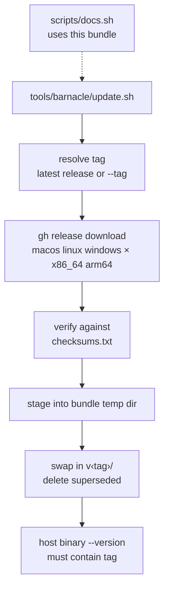

# The barnacle bundle (`tools/barnacle/`)



[Barnacle](https://github.com/fordaj/barnacle) is a documentation-site generator: it renders the `.md` and `.mmd` files scattered through a repository into a static, navigable HTML site. This repository uses it to render *this* documentation; the site you may be reading was built by it.

## Layout

```text
tools/barnacle/
  update.sh                     # refresh from fordaj/barnacle releases
  v0.0.1.0.17/
    macos-arm64/barnacle
    macos-x86_64/barnacle
    linux-arm64/barnacle
    linux-x86_64/barnacle
    windows-arm64/barnacle.exe
    windows-x86_64/barnacle.exe
```

All six platforms are bundled. The pinned v0.0.1.0.17 bundle in this repository currently carries only the binaries (no `LICENSE` files in the tree).

## `update.sh` in detail

The script is a thin wrapper around [../update.sh.md](../update.sh.md) (the shared implementation). Bundle-specific behaviour: it refreshes from `fordaj/barnacle` releases, accepts every platform archive, keeps the `barnacle[.exe]` binary, copies the upstream MIT `LICENSE` next to each binary when present, and warns (rather than aborts) when a release ships no checksums file.

Environment overrides: `BARNACLE_REPO`, `BARNACLE_TAG`. `--dry-run` lists assets and planned deletions without touching anything.

Note this bundle is refreshed independently of the runner-spawner release pipeline — run `tools/barnacle/update.sh` after a docs-tooling bump, not as part of `scripts/release.sh`.

## How the repository uses it

[scripts/docs.sh](../../scripts/docs.sh.md) resolves `BARNACLE_BIN` through the [env cascade](../../scripts/env.sh.md) and generates `./site/` from the repo root; the output is git-ignored.

## Related pages

- [../README.md](../README.md) — the bundle index
- [../../scripts/README.md](../../scripts/README.md) — the scripts that consume the bundle
- [../../scripts/docs.sh.md](../../scripts/docs.sh.md)
