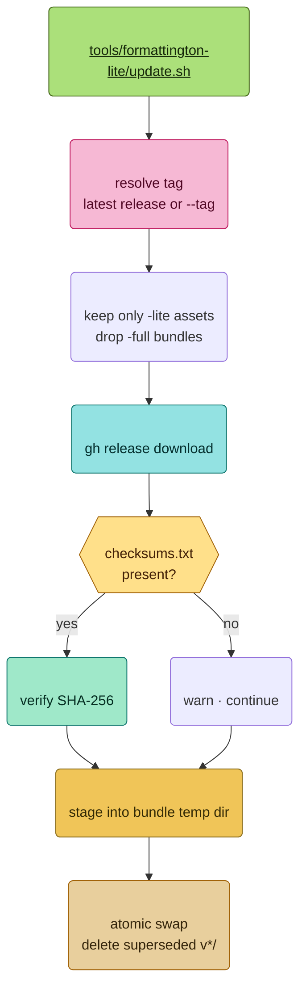

# The formattington-lite bundle (`tools/formattington-lite/`)

[Formattington](https://github.com/fordaj/formattington) is the formatter orchestrator this repository uses via [`format.sh`](../../scripts/format.sh.md) — but the committed `pyproject.toml`/`uv.lock` pin a git commit for the *real* formatting runs. This bundle carries the **formattington-lite** release asset — the bare `formattington` binary without embedded formatter executables — for convenience and uniformity.

**It is not part of the env cascade** (`scripts/.common.env` sets nothing for it) and nothing in the scripts resolves it; the other four bundles are the cascade-backed ones.

## Bundled platforms

`v0.0.3.0.67/macos-arm64`, `macos-x86_64`, `linux-arm64`, `linux-x86_64`, `windows-arm64`, `windows-x86_64`.

## `update.sh` in detail

Refreshes from `fordaj/formattington` releases via the shared implementation in [../update.sh.md](../update.sh.md). Bundle-specific behaviour: only the platform archives whose stem ends in `-lite` are kept (a `-lite` suffix filter drops everything else, e.g. `-full` bundles). Checksums are verified when the release ships `checksums.txt`/`SHA256SUMS.txt` (warning, not fatal, when absent). Only the `formattington[.exe]` binary is kept, plus `NOTICE.md` and `LICENSES/` when the extracted archive carries them. Smoke-tests the host binary (`formattington --version`).

Environment overrides: `FORMATTINGTON_REPO`, `FORMATTINGTON_TAG`. `--dry-run` lists planned assets without touching anything.

## Related pages

- [../README.md](../README.md) — the bundle index
- [../../scripts/README.md](../../scripts/README.md) — the scripts that consume the cascade-backed bundles
- [../../scripts/format.sh](../../scripts/format.sh.md) — how formatting is actually wired up here
