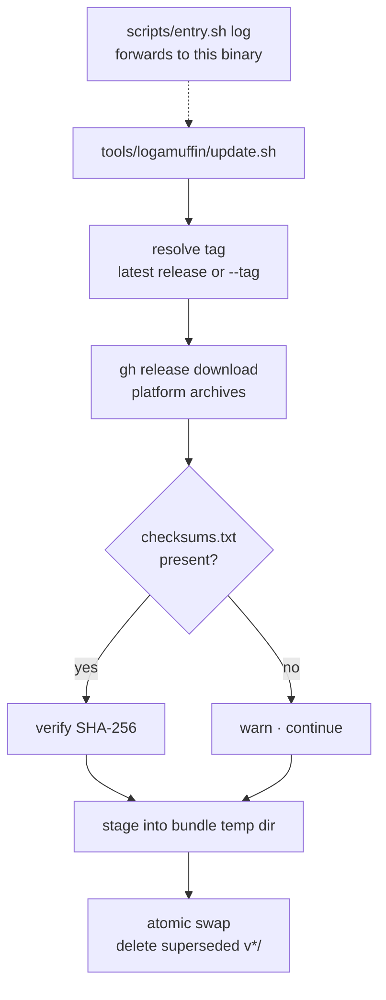

# The logamuffin bundle (`tools/logamuffin/`)

[Logamuffin](https://github.com/fordaj/logamuffin) is the structured logger used by this repository's scripts: timestamped, leveled `log <level> <message>` records. The scripts' `log()` wrapper ([scripts/entry.sh.md](../../scripts/entry.sh.md)) forwards to the pinned binary when it is present and falls back to an equivalent `printf` implementation when it is not, so a fresh clone works without it.

The scripts themselves document the contract (`log INFO "..."`), the `LOG_LEVEL`/`LOGAMUFFIN_LEVEL` filter, and the `LOG_SOURCE` caller-context field that entry.sh injects.

## Bundled platforms

`v0.1.3.0.35/macos-arm64`, `macos-x86_64`, `linux-arm64`, `linux-x86_64`, `windows-arm64`, `windows-x86_64` (the scripts pick the host's platform via `LOGAMUFFIN_BIN`).

## `update.sh` in detail

Refreshes from `fordaj/logamuffin` releases via the shared implementation in [../update.sh.md](../update.sh.md). Bundle-specific behaviour: accepts every platform archive, maps its `<os>-<arch>` suffix onto the bundle layout (e.g. `darwin-amd64` → `macos-x86_64`), verifies against the release's `checksums.txt`/`SHA256SUMS.txt` when present — warning rather than fatal when absent. Only the binary is kept. Smoke-tests the host binary.

Environment overrides: `LOGAMUFFIN_REPO`, `LOGAMUFFIN_TAG`. `--dry-run` lists planned assets without touching anything.

## Related pages

- [../README.md](../README.md) — the bundle index
- [../../scripts/entry.sh.md](../../scripts/entry.sh.md) — the `log()` wrapper that calls it
