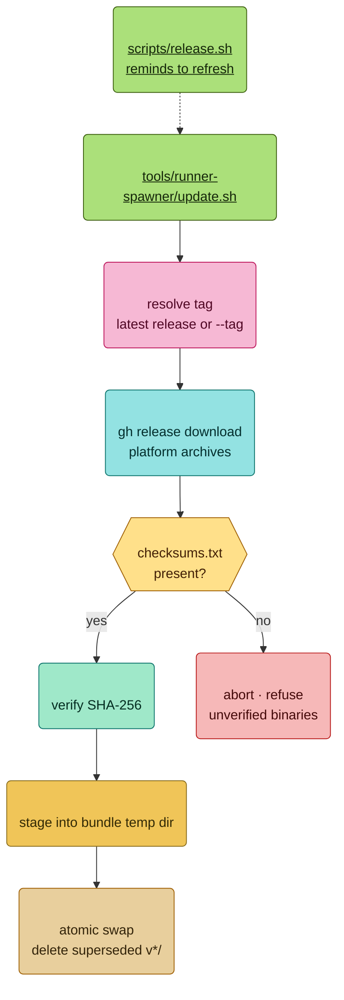

# The runner-spawner bundle (`tools/runner-spawner/`)

[Runner-spawner](https://github.com/fordaj/runner-spawner) **is this repository** — the same CLI this tree builds from source. This bundle pins the latest *released* binaries so scripts and CI can run the published artifact without building it. The currently pinned release is **`v0.0.1.2.15`**; the committed `.runner-spawner.json` targets this repository itself (`owner: fordaj`, `repo: runner-spawner`, `runnerNames: ["runner01"]`).

## Bundled platforms

`v0.0.1.2.15/macos-arm64`, `macos-x86_64`, `linux-arm64`, `linux-x86_64`, `windows-arm64`, `windows-x86_64`. Note: runner-spawner reports unsupported on Linux (macOS + Windows only); the Linux binaries are shipped for uniform bundle layout, and the Linux platform env files carry this caveat.

The pinned binary selection goes through the [env cascade](../../scripts/env.sh.md) (`RUNNER_SPAWNER_BIN`). The bundle refresh deliberately uses a different variable name — `RUNNER_SPAWNER_TOOL_REPO` (set in `.common.env`, defaulting to `fordaj/runner-spawner`) — because `RUNNER_SPAWNER_REPO` is this CLI's own env var for the *target* repository a runner should be created for. Do not confuse the two.

## `update.sh` in detail

Refreshes from `fordaj/runner-spawner` releases via the shared implementation in [../update.sh.md](../update.sh.md). Bundle-specific behaviour: accepts every platform archive. **Verification is mandatory: a release with no `checksums.txt`/`SHA256SUMS.txt` aborts the refresh** — the one bundle here that refuses unverified binaries. Only the binary is kept. Smoke-tests the host binary (`runner-spawner --version`). Environment overrides: `RUNNER_SPAWNER_TOOL_REPO`, `RUNNER_SPAWNER_TAG`. `--dry-run` lists planned assets without touching anything.

Note: the wrapper honors `RUNNER_SPAWNER_TOOL_REPO` (never the CLI's own `RUNNER_SPAWNER_REPO`, which is the *target* repository env var).

`scripts/release.sh` prints a reminder to refresh this bundle with `tools/runner-spawner/update.sh` after publishing a release.

## Related pages

- [../README.md](../README.md) — the bundle index
- [../../scripts/env.sh.md](../../scripts/env.sh.md) — the cascade selecting `RUNNER_SPAWNER_BIN`
- [../../scripts/release.sh.md](../../scripts/release.sh.md) — the release pipeline
- [../../README.md](../../README.md) — the root README (CI section)
