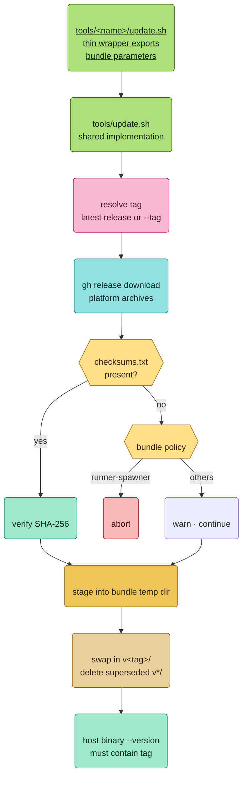

# The shared bundle refresh (`tools/update.sh`)

`tools/update.sh` is the single implementation behind every bundle's
`update.sh`. The per-bundle scripts under `tools/<name>/update.sh` are thin
wrappers: they export the bundle's parameters (`UPDATE_TOOL`, `UPDATE_BIN`,
`UPDATE_REPO`, `UPDATE_ASSET_SUFFIX`, `UPDATE_EXTRAS`,
`UPDATE_REQUIRE_CHECKSUMS`, `TAG`, `REPO`) and exec this script, so usage,
flags and semantics are identical across bundles. Run the wrapper for the
bundle you want — never this file directly.

## Flags

- `--dry-run` / `-n` — resolve the tag and list the planned assets and old-version deletions; touches nothing.
- `--tag TAG` — pin a specific release tag (default: latest release; validated against `^v[0-9]+(\.[0-9]+)+$`).
- `--repo REPO` — repository slug (default: the bundle's documented slug).
- `--help` / `-h` — usage.

## Structure

The script is a linear pipeline built from named stages, each one independently understandable: argument parsing → tag resolution → `print_dry_run` (when `--dry-run`) or `download → verify_checksums → install_archive (per archive) → swap in v<tag>/ → prune old folders → report_host_binary`. Platform-name mapping is centralized in `parse_stem_to_platform` (asset stems → `<os>-<arch>` bundle names) and `host_platform` (this machine).

## What the shared implementation does

1. Resolves the tag (latest release, or `--tag`), validating its shape.
2. Downloads the release assets via `gh` (`*.tar.gz`, `*.zip`, legacy `*.7z`, plus `checksums.txt`/`SHA256SUMS.txt`), optionally filtering archives by an asset-stem suffix (`UPDATE_ASSET_SUFFIX`, e.g. `-lite` for formattington-lite).
3. Verifies the downloaded archives against the checksums file (`shasum -a 256 -c` or `sha256sum -c`), checking only the archives downloaded for this run. A missing checksums file aborts the refresh when `UPDATE_REQUIRE_CHECKSUMS=1` (the runner-spawner bundle) and warns otherwise.
4. Extracts each archive, maps the asset's `<os>-<arch>` suffix onto the bundle layout (`darwin-amd64` → `macos-x86_64`, …), and copies the binary (`UPDATE_BIN`) into `v<tag>/<platform>/`, preserving the executable bit. Extra files and directories declared in `UPDATE_EXTRAS` (e.g. `LICENSE`, `NOTICE.md LICENSES`) are copied alongside with `cp -pr` when present.
5. Swaps the new version directory in atomically and deletes superseded `v*/` folders only after the swap, then smoke-tests the host binary (`<bin> --version`), warning if the reported version does not contain the tag.

Environment overrides are per-bundle (`UPDATE_REPO`/`TAG` defaulted by each wrapper from its own variables, e.g. `BARNACLE_REPO`/`BARNACLE_TAG`); `--repo`/`--tag` override them. Logging goes through `log <level> <message>` from [scripts/entry.sh](../scripts/entry.sh.md) (logamuffin, with a printf fallback).

## Why one shared script

The five bundles are refreshed by the same algorithm with only the repository slug, binary name, asset-suffix filter, extra files, and checksum policy differing. One implementation keeps that contract from drifting between bundles.

## Related pages

- [README.md](README.md) — the bundle index
- [release.sh.md](../scripts/release.sh.md) — the release pipeline (reminds to refresh the runner-spawner bundle)
- [env.sh.md](../scripts/env.sh.md) — the cascade selecting the pinned binaries
