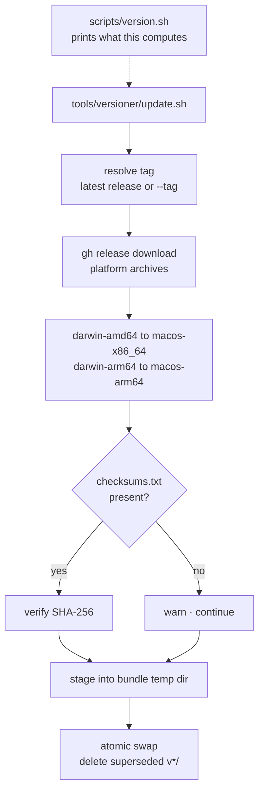

# The versioner bundle (`tools/versioner/`)

[Versioner](https://github.com/fordaj/Versioner) computes the version of this repository from its Git history, under the rules in `.versioner.json` (`defaultBranchVersion: 254`, `exemptBranches: { main: 0 }`, `tagPattern: v[0-9]*`). The release pipeline asks versioner for the next version, stamps it into every cross-compiled binary, tags the commit, and creates the GitHub release.

The pinned binary selection goes through the [env cascade](../../scripts/env.sh.md) (`VERSIONER_VERSION_DIR`/`VERSIONER_BIN`); [scripts/version.sh](../../scripts/version.sh.md) prints what it computes, and the release pipeline uses the same computation so `runner-spawner --version` agrees with the published tag (see [../../version.go.md](../../version.go.md)).

## Bundled platforms

`v0.0.3.0.5/macos-arm64`, `macos-x86_64`, `linux-arm64`, `linux-x86_64`, `windows-x86_64`. There is **no windows-arm64 bundle upstream** — the windows-arm64 platform file pins `VERSIONER_BIN` at the `windows-x86_64` binary and records this in a comment; set `VERSIONER_BIN` to a versioner on PATH if you need something else there.

## `update.sh` in detail

Refreshes from `fordaj/Versioner` releases: platform archives (stem ends in `<os>-<arch>`; `.tar.gz` on macOS/Linux, `.zip` on Windows, legacy `.7z` accepted), mapped onto the bundle layout (e.g. `darwin-amd64` → `macos-x86_64`), verified against the release's `checksums.txt`/`SHA256SUMS.txt` when present — warning rather than fatal when absent. Only the binary is kept. Stages into a temporary directory inside the bundle, swaps in atomically, prunes superseded `v*/` folders only after the new one is staged, and smoke-tests the host binary (`versioner --version`). Environment overrides: `VERSIONER_REPO`, `VERSIONER_TAG`. `--dry-run` lists planned assets without touching anything.

## Related pages

- [../README.md](../README.md) — the bundle index
- [../../scripts/version.sh.md](../../scripts/version.sh.md)
- [../../scripts/release.sh.md](../../scripts/release.sh.md)
