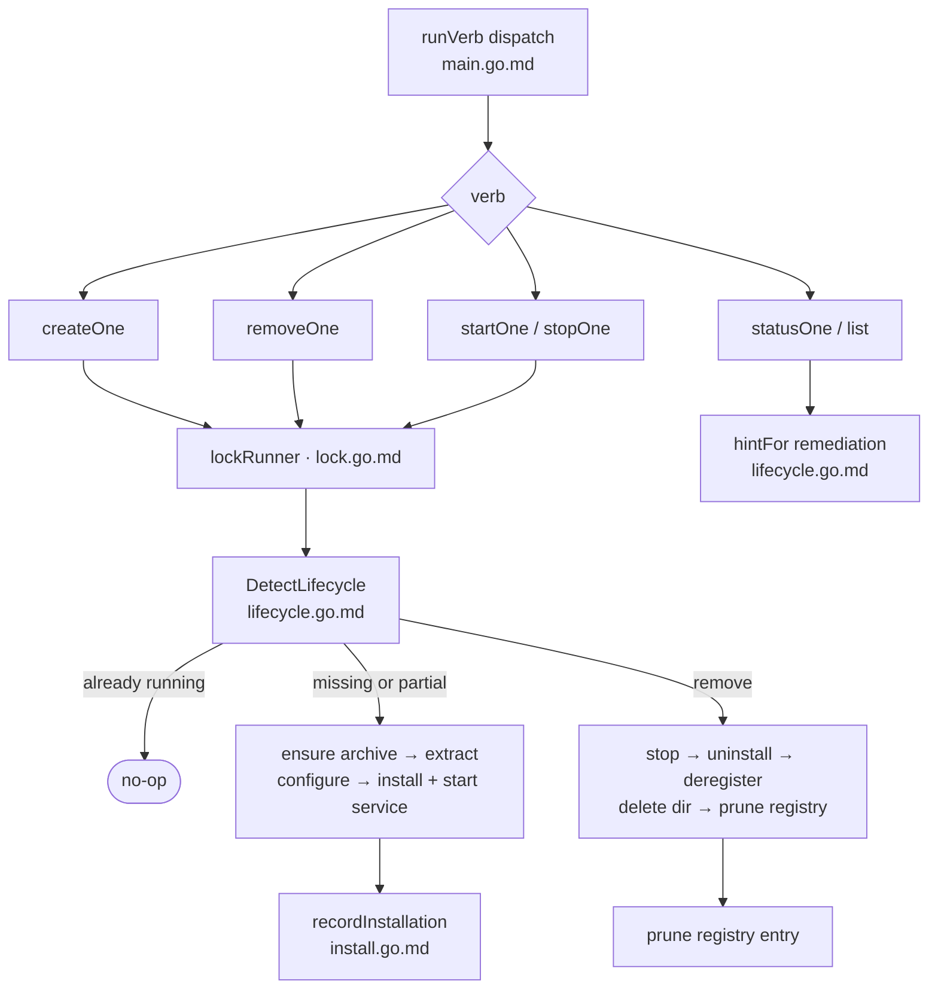

# The verbs (`verbs.go`)

`verbs.go` is the largest file in the module: it implements the per-installation operations behind `create`, `remove`, `start`, `stop`, `status` and `list`. Shared plumbing (scope, locks, archive, platform) lives in the sibling files; this file is the orchestration layer.

## Status assembly

- `runnerStatus` — one line of `list`/`status` output; `statusOne` wraps `DetectLifecycle` ([lifecycle.go.md](lifecycle.go.md)) and attaches the remediation `hint`.
- `queryServiceState` — best-effort, never errors: macOS probes the LaunchAgent plist then `svc.sh status` (`STARTED`/`STOPPED`/`NOT INSTALLED`, else `unknown`); Windows reads the numeric `STATE` code from `sc.exe query` (see [lifecycle.go.md](lifecycle.go.md)).
- `listNames` — union of config names and on-disk runner dirs (excluding `cache`/`.locks`), sorted — what makes a bare `list` useful.

## create

`createOne` requires a supported platform and (on Windows) elevation, takes the per-runner lock ([lock.go.md](lock.go.md)), then converges from any partial state: no-ops on an already-running runner; otherwise (via `ensureWindowsCredentials` for the `--runasservice` account on Windows) ensures the archive (verified version marker or missing/partial install), extracts **atomically** ([archive.go.md](archive.go.md)), skips `config.sh` when `.runner` exists (issue #3 interruption), installs and starts the service (`svc.sh` + LaunchAgent on macOS; `config.cmd --runasservice` + `sc.exe` on Windows — `ensureUnixService`/`ensureWindowsService`), records the installation marker and registry entry ([install.go.md](install.go.md)), and verifies the post-conditions (`.runner` exists + service running) before reporting success. `--replace` is passed to `config.sh` so stale GitHub registrations with the same name are superseded in place.

## remove

`removeOne` delegates the local teardown to `removeLocalService` (stop → uninstall → wait, with orphan cleanup for partial/gone installs; `waitForServiceUninstalled` fails loudly when the service survives), then deregisters from GitHub (`deregisterRemote`; `--local-only` skips it; a missing token warns and proceeds — local removal still happens and output names the remaining GitHub-side cleanup), deletes the runner dir, and prunes the registry. Re-running completes a previously failed GitHub deregistration (admin API fallback when the dir is already gone). An empty/partial runner dir is deleted after best-effort deregistration.

## start/stop

`startOne`/`stopOne` delegate to `controlOne` — idempotent, status-aware: starting an already-running runner and stopping an already-stopped one are safe no-ops; missing or unconfigured installations get an actionable error. Mutations never reach GitHub (deregistration is `remove`'s job).

## Windows account prompt

`readPromptLine` drives the interactive prompt for the Windows service account (`--windows-username`/`--windows-password`, env vars, or interactive); callers prompting for a secret print a trailing newline themselves. Passwords are never printed and never written to the config file.

## Shared helpers

- `newLoggers(cfg, stderr)` — the `logf` (suppressed by `--quiet`) and `warnf` (always prints) closures used by every mutating verb.
- `scMissingService(err, out)` — whether a failed `sc.exe` call means the service is gone (exit 1060/1072, or the raw code in the output), used for the Windows not-installed probe and for tolerating `sc.exe delete` against an absent service.

## Related pages

- [archive.go.md](archive.go.md) — download and atomic extraction
- [lifecycle.go.md](lifecycle.go.md) — the state machine these verbs consume
- [install.go.md](install.go.md) — markers/registry written here
- [lock.go.md](lock.go.md) — per-runner serialization
- [token.go.md](token.go.md) — registration token resolution
- [scope.go.md](scope.go.md) — batch dispatch around these verbs
