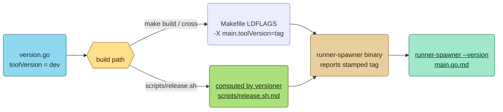

# Version stamping (`version.go`)

`version.go` holds exactly one declaration: `toolVersion`, the string printed by `runner-spawner --version` (`runner-spawner <version>`) and read at startup by [main.go.md](main.go.md).

## How it resolves

`toolVersion` is `"dev"` in source and is replaced at link time with `-ldflags="-X main.toolVersion=<tag>"`. Both build paths inject it:

- `make build` / `make cross` (Makefile `LDFLAGS`)
- `scripts/release.sh` (see [scripts/release.sh.md](scripts/release.sh.md)), which computes the next tag with the bundled versioner and stamps it into every cross-compiled binary

A plain `go build` therefore reports `runner-spawner dev`; release artifacts report their tag. The pinned bundle under `tools/runner-spawner/` is built the same way (see `tools/runner-spawner/update.sh.md`).

## Related pages

- [main.go.md](main.go.md) — the `--version` subcommand
- [scripts/version.sh.md](scripts/version.sh.md) — prints the computed tag without building
- [scripts/release.sh.md](scripts/release.sh.md) — where the `-X` injection happens for releases
